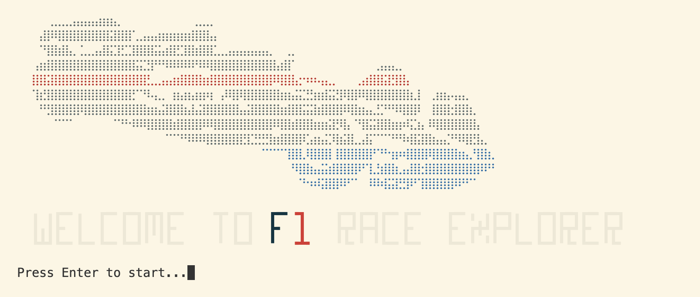
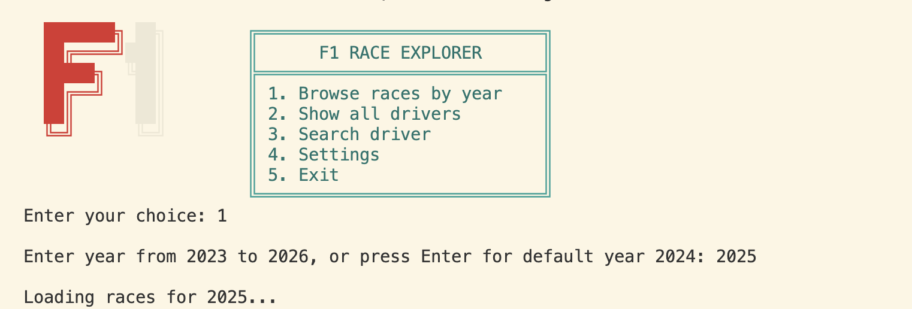
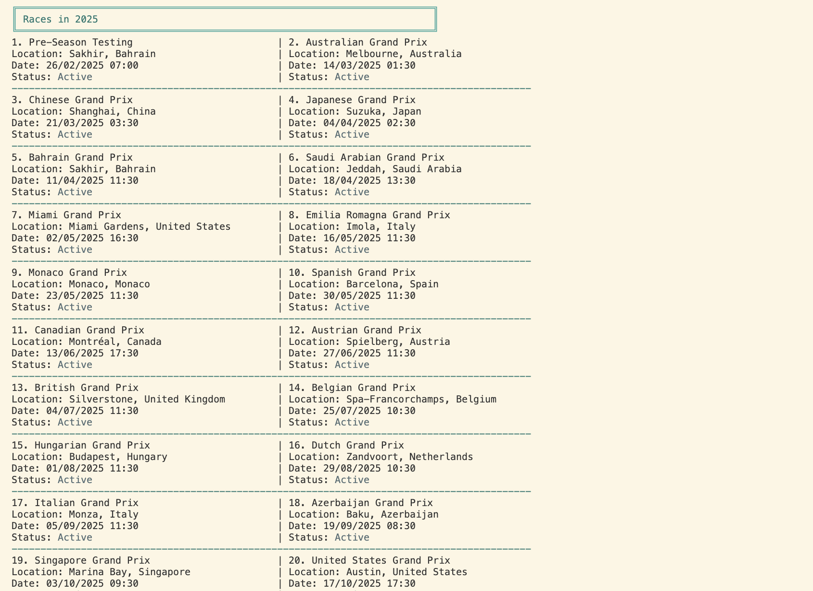
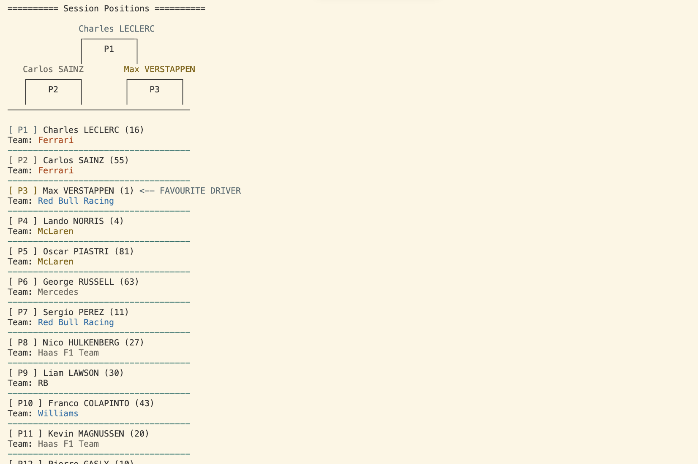
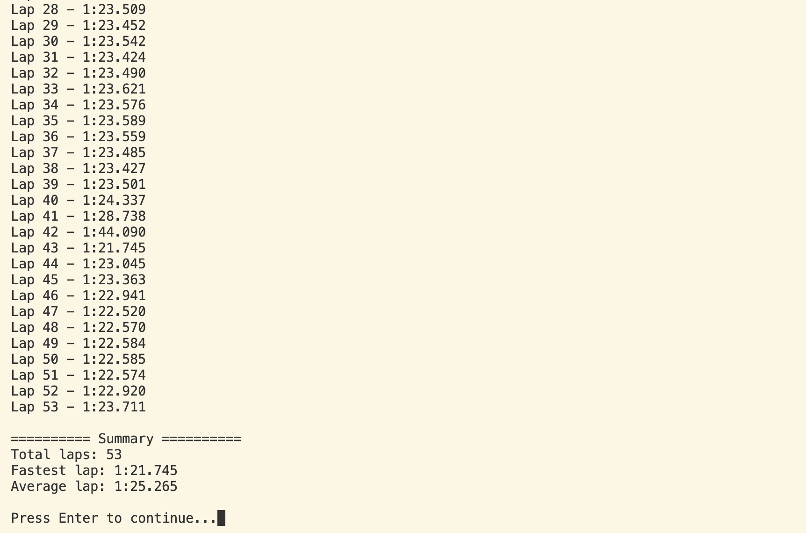

# F1 Race Explorer – User Manual

## 1. Introduction

Welcome to F1 Race Explorer!

This is a console-based Java application that uses data from
the OpenF1 API.

In this application, users can browse races, drivers,
sessions, positions and lap data.

This project was developed as part of my university
programming studies.

<p align="center">
  
</p>

## 2. Features

- Browse races by year
- View sessions
- View drivers
- Search drivers
- View lap times
- View session positions
- Favourite driver selection
- Persistent user settings
- Offline fallback
- Custom ASCII art and terminal interface

## 3. API and Data Handling

The application uses the OpenF1 API:

https://api.openf1.org

Data is retrieved using endpoints such as:

- `meetings`
- `sessions`
- `drivers`
- `laps`
- `positions`

Data is requested using HTTP connections and returned in
JSON format. This data is then parsed into Java objects
such as Race, Driver, Session, Lap and Position.

To improve reliability, successful responses are saved
locally in cache files.

If the API is unavailable, the program attempts to load
data from the cache instead.

### API Availability

Free OpenF1 API access may be restricted during live
Formula 1 sessions.

Offline functionality requires previously cached data.
The repository does not include a pre-populated cache.

## 4. How to Use the App

1. Run the program.
2. Press Enter to start.
3. Choose an option from the main menu.

<p align="center">
  
</p>

### Browse Races by Year

The user can enter a year or simply press Enter to use
the default year.

The program then loads and displays the available races
for that year.

<p align="center">
  
</p>

The user can then select a race and view its sessions.

Inside a session, the user can:

- View drivers
- View session positions
- Search driver lap times
- View session information

### Session Positions

The application displays driver positions, team names
and an ASCII-style podium.

The favourite driver is highlighted in the list.

Session positions are based on API position records and
may differ from official race classifications.

<p align="center">
  
</p>

### Lap Times

The user can search for a driver and view their lap times
within the selected session.

The application also displays:

- Total number of laps
- Fastest lap
- Average lap time

<p align="center">
  
</p>

### Show All Drivers

This option displays a list of drivers returned by the API.

Duplicate driver entries are filtered, and the favourite
driver is marked in the list.

### Search Driver

Users can search for drivers using their name, surname
or racing number.

## 5. Settings

Settings allow the user to change:

- Default year
- Favourite driver number

Settings are stored locally in `settings.txt`, which
allows the application to remember user preferences
between runs.

## 6. Installation & Running

Requirements:

- Java Development Kit (JDK 21 recommended)
- Terminal supporting ANSI colours and UTF-8
- org.json library (version 20250107)

Run the following commands from the project root.

### Download the JSON Library

```bash
mkdir -p lib
curl -fL https://repo.maven.apache.org/maven2/org/json/json/20250107/json-20250107.jar -o lib/json-20250107.jar
```

### Compile

```bash
javac -encoding UTF-8 -cp "lib/*" -d bin src/f1explorer/*.java
```

### Run (macOS / Linux)

```bash
java -cp "bin:lib/*" f1explorer.Main
```

### Run (Windows)

```bash
java -cp "bin;lib/*" f1explorer.Main
```

On Windows, the JSON library must first be downloaded
into the lib folder. The compilation command above
can be used in Command Prompt.

## 7. Technologies

- Java
- Object-oriented programming
- REST API integration
- HTTP connections
- JSON parsing
- File I/O
- Local data caching
- ANSI escape codes

## 8. Author & Credits

Developed by Ivan Pereverziev.

Data provided by [OpenF1](https://openf1.org/).

JSON processing using [JSON-java](https://github.com/stleary/JSON-java).

This is an independent educational project and is not
affiliated with Formula 1.

Thanks for using F1 Race Explorer!

See you at the next Grand Prix.